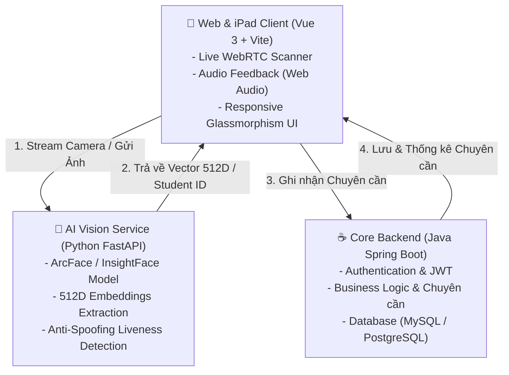

# 🚀 SpaceX - Biometric Face Attendance & AI Vision System

<p align="center">
  
  
  
  
  
</p>

---

## 📌 Giới Thiệu Dự Án (Overview)

**SpaceX Biometric Attendance System** (Dự án White Queen) là giải pháp quản lý chuyên cần và điểm danh sinh viên tự động thế hệ mới ứng dụng công nghệ **AI Nhận diện khuôn mặt (Face Recognition)**. Hệ thống lấy cảm hứng từ nền tảng **facEthic** và được định hình theo phong cách công nghệ vũ trụ **SpaceX**: hiện đại, tối giản và độ chính xác cực cao.

Sinh viên chỉ cần đứng trước camera iPad hoặc thiết bị di động, hệ thống AI sẽ phát hiện khuôn mặt, so khớp vector đặc trưng 512 chiều trong **0.3 giây** và ghi nhận chuyên cần ngay lập tức.

---

## 🏛️ Kiến Trúc 3 Tầng (3-Tier Architecture)



---

## ✨ Tính Năng Nổi Bật (Key Features)

### 1. 🏠 Landing Page Tối Tân (SpaceX Hero)
- Thiết kế nền đen công nghệ (`#050608`) với hiệu ứng hạt sáng vũ trụ (*particle sparks*).
- Typography tiêu đề vàng `#FFE600` nổi bật (*Daily Student Record Management System*).
- **Watermark SpaceX khổng lồ** cùng vệt quỹ đạo tên lửa bay xuyên qua chữ `X`.
- **Con trỏ chuột tùy biến (Custom Follower Cursor):** Vòng tròn outline lướt mượt mà theo trỏ chuột người dùng.
- **Banner Cookie Consent:** Quản lý quyền riêng tư với nút Reject và Accept viền vàng.

### 2. 🔐 Màn Hình Đăng Nhập 3D Papercut (`LoginView`)
- Nền tranh cắt giấy 3D nghệ thuật đa tầng (*Papercut Clouds*) hoàng hôn rực rỡ kết hợp bóng hologram AI.
- Watermark thương hiệu SpaceX tích hợp tinh tế ở nền trời.
- Bộ chọn 3 loại tài khoản trực quan:
  - **Face Registration** (Đăng ký khuôn mặt mới).
  - **Educator Account** (Tài khoản giáo viên / quản trị).
  - **Student Account** (Tài khoản học sinh - *Coming Soon*).

### 3. 📷 Máy Quét Điểm Danh iPad (`ScannerView`)
- Truy cập trực tiếp Camera WebRTC với độ trễ siêu thấp.
- Khung nhận diện góc vuông sci-fi và tia laser HUD quét dọc mượt mà.
- **Âm thanh sinh động (Web Audio API Synthesizer):** Âm báo *chime* thành công (ngân vang 2 nốt C5-G5), âm *buzzer* cảnh báo khi chưa đăng ký.
- Badge bảo mật độc quyền: `SPACEX SECURE BIO-SCAN | v2.4`.
- Bộ lọc chọn Lớp học, Môn học linh hoạt.

### 4. 👤 Đăng Ký Sinh Viên & Face Enrollment (`EnrollmentView`)
- Chụp ảnh trực tiếp từ webcam với hướng dẫn giữ khuôn mặt trong khung oval.
- Trích xuất và mô phỏng vector embedding 512 chiều của mô hình ArcFace.
- Nhập thông tin Mã sinh viên, Họ tên, Lớp, Email để lưu trữ vào hệ thống.

### 5. 📊 Báo Cáo & Xuất Dữ Liệu (`DashboardView`)
- Thống kê tỷ lệ có mặt theo thời gian thực (Present, Absent, Attendance Rate %).
- Bảng nhật ký điểm danh có ảnh đại diện, lớp, trạng thái và thời gian chính xác tới từng giây.
- **Bộ lọc thông minh:** Lọc theo trạng thái, tìm kiếm theo tên / MSSV.
- **Xuất file CSV:** Tải báo cáo chuyên cần về máy tính chỉ với 1 click.

### 6. ⚙️ Cấu Hình Kết Nối API (`SettingsModal`)
- Cho phép chuyển đổi linh hoạt giữa chế độ **Giả lập (Local Mock)** và **Kết nối Backend thật (Live 3-Tier API)**.
- Tùy chỉnh URL Java Spring Boot (`http://localhost:8080/api`) và Python AI (`http://localhost:8000`).

---

## 📂 Cấu Trúc Thư Mục (Project Structure)

```text
web-frontend/
├── index.html                      # File HTML chính, cấu hình Font Plus Jakarta Sans & Favicon
├── vite.config.js                  # Cấu hình Vite Build Tool
├── package.json                    # Khai báo Dependencies & Scripts
├── public/                         # Tài nguyên tĩnh
└── src/
    ├── main.js                     # Điểm khởi chạy ứng dụng Vue 3
    ├── style.css                   # Hệ thống Design System (Tokens, Glassmorphism, Animations)
    ├── App.vue                     # Component gốc điều hướng màn hình & thông báo toàn cục
    ├── assets/                     # Hình ảnh, biểu tượng vector
    ├── components/
    │   ├── CustomCursor.vue        # Con trỏ chuột vòng tròn lướt mượt theo cử động
    │   ├── CookieBanner.vue        # Banner thông báo Cookie đáy màn hình
    │   ├── SpaceXLogo.vue          # Logo vector SpaceX chuẩn với biểu tượng quỹ đạo
    │   ├── FacEthicLanding.vue     # Trang chủ giới thiệu giải pháp (Dark SpaceX Theme)
    │   ├── LoginView.vue           # Màn hình đăng nhập mây 3D Papercut nghệ thuật
    │   ├── ScannerView.vue         # Máy quét điểm danh thời gian thực camera iPad
    │   ├── EnrollmentView.vue      # Chụp và đăng ký dữ liệu khuôn mặt sinh viên
    │   ├── DashboardView.vue       # Bảng điều khiển quản lý và xuất CSV báo cáo
    │   ├── HeaderNav.vue           # Thanh điều hướng trên cùng các trang quản trị
    │   └── SettingsModal.vue       # Cửa sổ cấu hình kết nối API 3-tier
    └── utils/
        ├── sound.js                # Bộ phát âm thanh tự tạo bằng Web Audio API
        └── storage.js              # Quản lý LocalStorage & Service API Adapter
```

---

## 🛠️ Hướng Dẫn Cài Đặt & Chạy Dự Án (Getting Started)

### Yêu Cầu Môi Trường:
- **Node.js**: v18.0.0 trở lên
- **Trình duyệt**: Chrome, Edge, Safari hoặc Firefox có hỗ trợ WebRTC Camera

### 1. Di chuyển vào thư mục frontend:
```bash
cd web-frontend
```

### 2. Cài đặt các gói phụ thuộc:
```bash
npm install
```

### 3. Chạy môi trường phát triển (Development Server):
```bash
npm run dev
```
> Trình duyệt sẽ mở ứng dụng tại: `http://localhost:5173/` hoặc `http://localhost:5174/`

### 4. Đóng gói bản Production:
```bash
npm run build
```

---

## 🌐 Tích Hợp API Backend (Integration Guide)

Hệ thống được thiết kế sẵn sàng cho việc tích hợp với Backend:

| Dịch vụ | Công nghệ | Cổng mặc định | Chức năng chính |
| :--- | :--- | :--- | :--- |
| **Frontend** | Vue 3 + Vite | `5173` / `5174` | Giao diện tương tác, quét camera, hiển thị số liệu |
| **Core Backend** | Spring Boot | `8080` | Quản lý sinh viên, lưu vết chuyên cần, xác thực JWT |
| **AI Vision** | FastAPI (Python) | `8000` | ArcFace trích xuất 512D embedding, anti-spoofing |

---

## 👨‍💻 Tác Giả & Bản Quyền

- **Dự án**: White Queen Attendance System
- **Repository**: [GitHub tranhongminh055/White-Queen-Attendance](https://github.com/tranhongminh055/White-Queen-Attendance)
- **Thiết kế & Bản quyền**: © 2026 SpaceX Smart Biometric Vision System. All Rights Reserved.
