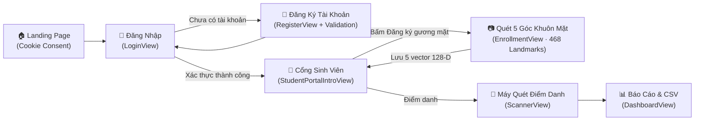

# 🚀 SpaceX - Biometric Face Registration & Attendance System

<p align="center">
  
  
  
  
</p>

---

## 📌 Giới Thiệu Dự Án (Overview)

**SpaceX Biometric System** (Dự án **White Queen**) là ứng dụng web đăng ký khuôn mặt và điểm danh sinh viên bằng **AI Sinh trắc học thời gian thực ngay trên trình duyệt** (WebRTC Camera + MediaPipe FaceLandmarker + `@vladmandic/face-api`).

Toàn bộ luồng xác thực, quét 5 góc khuôn mặt, trích xuất vector đặc trưng `128-D` và lưu trữ hồ sơ đều vận hành **100% bằng camera thật và suy luận AI thật** — **không dùng dữ liệu mẫu giả lập (mock data)**.

---

## 🧭 Luồng Hoạt Động Chính (User Flow)



- Điều hướng sử dụng **Browser History API** (`pushState` / `popstate`) đồng bộ hash `#tab` cùng nút `←` / `→` / `Quay lại` ở header và từng màn hình.
- Các màn hình bảo vệ (`face-intro`, `enrollment`, `scanner`, `dashboard`) yêu cầu đã **Accept Cookie** và **đăng nhập tài khoản hợp lệ** trước khi truy cập.

---

## ✨ Tính Năng Đã Hoàn Thiện

### 1. 🏠 Landing Page (`FacEthicLanding.vue` & `CookieBanner.vue`)
- Giao diện nền tối SpaceX kết hợp hiệu ứng hạt nền, `CustomCursor` theo trỏ chuột và `CookieBanner` kiểm soát quyền điều hướng.

### 2. 📝 Đăng Ký & 🔐 Đăng Nhập Thực (`RegisterView.vue`, `LoginView.vue`, `validation.js`)
- Kiểm tra chặt chẽ từng trường nhập liệu: Email, Họ tên, Mã sinh viên/nhân viên (`SX-00123`, `SV202601`...), độ mạnh mật khẩu (tối thiểu 8 ký tự gồm chữ hoa, chữ thường, chữ số và ký tự đặc biệt).
- Chống đăng ký trùng Email hoặc Mã sinh viên/nhân viên đã tồn tại trong `storage.js`.
- Hỗ trợ đăng nhập bằng mật khẩu hoặc **Đăng nhập bằng khuôn mặt thật** (so khớp Euclidean distance với vector `128-D` đã đăng ký).

### 3. 🪪 Cổng Giới Thiệu Sinh Viên (`StudentPortalIntroView.vue`)
- Hiển thị thẻ thông tin sinh viên đang đăng nhập, trạng thái sinh trắc học (`CHƯA ĐĂNG KÝ` / `ĐÃ ĐĂNG KÝ`), hướng dẫn 3 bước và nút **Đăng ký gương mặt**.

### 4. 📷 Đăng Ký Khuôn Mặt 5 Góc Thật (`EnrollmentView.vue` & `faceEngine.js`)
- **AI Engine lai 2 tầng chạy cục bộ** (tài nguyên đặt trong `public/mediapipe/` và `public/models/`, không phụ thuộc CDN ngoài):
  - **Google MediaPipe `FaceLandmarker`** (`468 điểm mốc`, ưu tiên `GPU` delegate và tự động dự phòng `CPU`) dò khuôn mặt, vẽ lưới wireframe `TESSELATION` + `CONTOURS` theo thời gian thực và tính góc đầu (`yaw`, `pitch`).
  - **`@vladmandic/face-api` (`faceRecognitionNet`)** trích xuất **vector đặc trưng `128-D`** trực tiếp từ khung mặt vừa xác nhận qua `extractFromLastAnalysis()`.
- **Tối ưu camera laptop mờ / sương / ngược sáng (`captureRawFrame`, `buildEnhancedPass` & `detectWithBacklitFallback`)**:
  - Đo histogram trong lõi trung tâm (`x: 32%..68%`, `y: 18%..74%`) để tránh ánh sáng cửa sổ rìa khung ảnh làm tối khuôn mặt.
  - Kéo giãn tương phản theo phân vị + nâng sáng vùng tối bằng bảng tra `Uint8Array(256)` LUT + bộ lọc làm nét 3×3 unsharp mask, kèm lượt phục hồi ngược sáng tăng cường nếu lượt 1 chưa bắt được mặt.
- Quét tuần tự **5 góc thật**: `Nhìn thẳng` → `Quay trái` → `Quay phải` → `Ngẩng lên` → `Cúi xuống` và chụp snapshot khuôn mặt thật lưu vào hồ sơ sinh viên.

### 5. 🎯 Máy Quét Điểm Danh & Báo Cáo (`ScannerView.vue`, `DashboardView.vue`)
- Nhận diện khuôn mặt thời gian thực qua WebRTC, so khớp khoảng cách Euclidean (`matchDescriptor`) với danh sách vector `128-D` đã đăng ký.
- Phát âm thanh phản hồi bằng Web Audio API (`sound.js`), thống kê chuyên cần theo lớp học và hỗ trợ xuất file CSV.
- Hỗ trợ cấu hình chế độ LocalStorage hoặc tích hợp API Backend qua `SettingsModal.vue`.

## 🗄️ Cơ Sở Dữ Liệu SQL Server (`SpaceXBiometricDB` trên `localhost\SQLEXPRESS25`)

- `dbo.Accounts`: Tài khoản đăng nhập/đăng ký (`EmployeeId`, `FullName`, `Email`, `Role`, `ClassId`, `PasswordHash` PBKDF2-HMAC-SHA256).
- `dbo.StudentProfiles`: Hồ sơ sinh viên/giảng viên (`StudentId`, `FullName`, `ClassId`, `Email`, `AvatarDataUrl`, `EmbeddingCreated`, `RegisteredAt`).
- `dbo.FaceEmbeddings`: Dữ liệu 5 góc khuôn mặt thật (`AngleKey`: `straight`, `left`, `right`, `up`, `down`, vector `DescriptorJson` 128 chiều, ảnh `SnapshotDataUrl`).
- `dbo.AttendanceLogs`: Nhật ký điểm danh thật theo ngày (`UQ_AttendanceLogs_Daily`).

---

## 📂 Cấu Trúc Thư Mục (Project Structure)

```text
White Queen/
├── README.md
├── backend/                                        # FastAPI + pyodbc REST API -> SQL Server
│   ├── db.py                                       # Kết nối SQL Server & khởi tạo CSDL tự động
│   ├── main.py                                     # Endpoints Auth, Face Enrollment 5 góc, Attendance
│   ├── requirements.txt                            # Python dependencies
│   ├── schema.sql                                  # Script SQL Server tạo DB & 4 bảng
│   └── security.py                                 # Băm & kiểm tra mật khẩu PBKDF2-HMAC-SHA256
└── web-frontend/
    ├── index.html                                  # HTML gốc ứng dụng
    ├── package.json                                # Dependencies & Vite scripts
    ├── vite.config.js                              # Cấu hình Vite + Proxy /api -> :8000
    ├── public/
    │   ├── mediapipe/
    │   │   ├── face_landmarker.task                # Model MediaPipe FaceLandmarker
    │   │   └── wasm/                               # MediaPipe Vision WASM runtime
    │   └── models/                                 # Trọng số @vladmandic/face-api (faceRecognitionNet...)
    └── src/
        ├── main.js                                 # Điểm khởi chạy Vue 3
        ├── style.css                               # Hệ thống giao diện & animations
        ├── App.vue                                 # Điều phối tab, History API, Auth/Cookie guards
        ├── assets/                                 # Hình ảnh & tài nguyên giao diện
        ├── components/
        │   ├── CookieBanner.vue                    # Banner chấp nhận/từ chối Cookie
        │   ├── CustomCursor.vue                    # Con trỏ chuột tùy biến
        │   ├── DashboardView.vue                   # Thống kê điểm danh & xuất CSV
        │   ├── EnrollmentView.vue                  # Quét camera thật 5 góc & trích xuất 128-D
        │   ├── FacEthicLanding.vue                 # Trang chủ SpaceX Biometric
        │   ├── HeaderNav.vue                       # Header điều hướng & nút Back/Forward
        │   ├── LoginView.vue                       # Đăng nhập tài khoản / khuôn mặt thật
        │   ├── RegisterView.vue                    # Đăng ký tài khoản với validate đầy đủ
        │   ├── ScannerView.vue                     # Máy quét điểm danh thời gian thực
        │   ├── SettingsModal.vue                   # Cấu hình kết nối SQL Server API
        │   ├── SpaceXLogo.vue                      # Logo SpaceX
        │   ├── SpaceXWatermark.vue                 # Watermark nền SpaceX
        │   └── StudentPortalIntroView.vue          # Cổng sinh viên trước khi quét mặt
        └── utils/
            ├── faceEngine.js                       # MediaPipe 468pt + 128-D + chống ngược sáng LUT
            ├── sound.js                            # Bộ phát âm thanh Web Audio API
            ├── storage.js                          # SQL Server REST API client
            └── validation.js                       # Validate form đăng ký & đăng nhập
```

---

## 🛠️ Hướng Dẫn Cài Đặt & Chạy Dự Án

### Yêu Cầu Môi Trường
- **SQL Server** (`localhost\SQLEXPRESS25`) + **ODBC Driver 18 for SQL Server**
- **Python**: 3.10+ (với `fastapi`, `uvicorn`, `pyodbc`, `pydantic`)
- **Node.js**: v18.0.0 trở lên
- **Trình duyệt**: Chrome / Edge hỗ trợ WebRTC Camera (`localhost` hoặc `HTTPS`)

### 1. Khởi chạy Backend API (SQL Server)
```bash
cd backend
pip install -r requirements.txt
python -m uvicorn main:app --host 127.0.0.1 --port 8000
```

### 2. Khởi chạy Frontend
```bash
# Di chuyển vào thư mục frontend
cd web-frontend

# Cài đặt dependencies
npm install

# Chạy môi trường phát triển (Development Server)
npm run dev
```
> Mở trình duyệt tại địa chỉ Vite hiển thị (mặc định `http://localhost:5173/`).

```bash
# Đóng gói bản Production
npm run build

# Xem trước bản build Production
npm run preview
```

---

## 👨‍💻 Thông Tin Dự Án

- **Dự án**: White Queen Attendance System
- **Repository**: [GitHub tranhongminh055/White-Queen-Attendance](https://github.com/tranhongminh055/White-Queen-Attendance)
