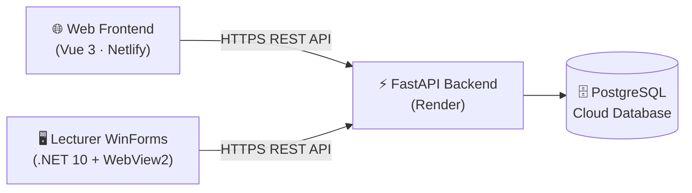

# 🚀 White Queen — SpaceX Biometric Face Registration & Attendance System

<p align="center">
  
  
  
  
  
</p>

---

## 📌 Giới Thiệu Dự Án (Overview)

**White Queen (SpaceX Biometric System)** là hệ thống đăng ký khuôn mặt và điểm danh sinh viên tự động bằng **AI Sinh trắc học thời gian thực**, gồm 3 thành phần đồng bộ:

1. **Web Portal (`web-frontend/`)**: Cổng sinh viên & người dùng trên trình duyệt (Vue 3 + Vite + MediaPipe + `@vladmandic/face-api`), triển khai trên **Netlify**.
2. **Backend REST API (`backend/`)**: Máy chủ **FastAPI** xử lý xác thực, lưu trữ vector khuôn mặt, quản lý lớp học, điểm danh AI và thống kê chuyên cần trên **PostgreSQL**, triển khai trên **Render**.
3. **Lecturer Desktop App (`lecturer-winform/`)**: Phần mềm Windows cho Giảng viên (**.NET 10 WinForms + WebView2**) tích hợp giao diện SpaceX HUD tối hiện đại, điểm danh AI tự động bằng camera, quản lý lớp học, lịch sử điểm danh 3 bước và xuất báo cáo đa định dạng.

Toàn bộ luồng xác thực, quét khuôn mặt, điểm danh và thống kê đều vận hành **100% bằng camera thật, suy luận AI thật và dữ liệu thật từ PostgreSQL** — không dùng dữ liệu giả lập (mock data).

---

## 🧭 Kiến Trúc & Luồng Hoạt Động



### Luồng Web Portal (Sinh viên)
1. **Landing Page & Cookie Banner**: Giới thiệu hệ thống SpaceX Biometric với hiệu ứng nền tương tác.
2. **Đăng ký & Đăng nhập**: Hỗ trợ tài khoản/mật khẩu (PBKDF2-HMAC-SHA256) và **đăng nhập bằng khuôn mặt thật**.
3. **Đăng ký khuôn mặt 5 góc**: Quét tuần tự `Nhìn thẳng` → `Quay trái` → `Quay phải` → `Ngẩng lên` → `Cúi xuống` với MediaPipe 468 landmarks, thuật toán chống ngược sáng LUT, trích xuất descriptor 128-D và lưu lên PostgreSQL.

### Luồng Phần Mềm Giảng Viên (`lecturer-winform`)
1. **Đăng nhập Giảng viên**: Hỗ trợ đăng nhập mật khẩu hoặc nhận diện khuôn mặt.
2. **Lớp học của tôi & Tạo lớp mới**:
   - Xem danh sách lớp học phần, sĩ số, lịch học, phòng học và danh sách sinh viên.
   - Tạo lớp mới và **import hàng loạt MSSV từ file Excel (`.xlsx`)**, tự động kiểm tra trạng thái hồ sơ & sinh trắc học từ PostgreSQL.
3. **Điểm danh AI tự động (Biometric HUD)**:
   - Giao diện quét HUD 4 bước trực quan, nhận diện khuôn mặt tự động liên tục qua camera thật.
   - Chống giả mạo (Liveness), tự động khớp sinh viên trong lớp, phát giọng nói tiếng Việt (TTS) chào mừng và lưu phiên điểm danh vào `AttendanceSessions` & `AttendanceLogs`.
4. **Lịch sử điểm danh 3 bước**:
   - **Bước 1 — Chọn lớp**: Thống kê tổng lớp, tổng buổi, tỷ lệ chuyên cần trung bình và biểu đồ cột từng lớp.
   - **Bước 2 — Chọn buổi**: Danh sách từng buổi điểm danh của lớp đã chọn, lọc theo trạng thái và sắp xếp mới/cũ nhất.
   - **Bước 3 — Bảng điểm danh chi tiết**: 5 KPI tổng quan, tìm kiếm MSSV/họ tên, lọc `Tất cả / Có mặt / Đi trễ / Vắng`, phân trang, xuất CSV và in báo cáo.
5. **Xuất báo cáo điểm danh**:
   - Chọn lớp học phần, chọn khoảng thời gian bằng preset hoặc **lịch 2 tháng tương tác** (đánh dấu ngày có buổi học thật).
   - Chọn 4 định dạng (`PDF`, `Excel UTF-8 BOM`, `CSV`, `JSON`), tùy biến nội dung, **Live Preview** tài liệu A4 + biểu đồ cột, tiến trình xuất 4 bước kèm terminal log và lịch sử **Báo cáo gần đây**.

---

## 🗄️ Cơ Sở Dữ Liệu PostgreSQL (`backend/pg_schema.sql`)

- `Accounts`: Tài khoản giảng viên / sinh viên (`EmployeeId`, `FullName`, `Email`, `Role`, `PasswordHash`).
- `StudentProfiles`: Hồ sơ sinh viên (`StudentId`, `FullName`, `ClassId`, `Email`, `AvatarDataUrl`, `EmbeddingCreated`).
- `FaceEmbeddings`: Dữ liệu vector khuôn mặt 5 góc (`AngleKey`, `DescriptorJson`, `SnapshotDataUrl`).
- `Classes` & `ClassStudents`: Danh sách lớp học phần và sinh viên thuộc từng lớp.
- `AttendanceLogs`: Nhật ký quét điểm danh theo sinh viên/lớp/ngày.
- `AttendanceSessions`: Thông tin từng buổi điểm danh (`TotalStudents`, `PresentCount`, `LateCount`, `AbsentCount`, `AttendanceRate`, `DetailsJson`).

---

## 📂 Cấu Trúc Thư Mục

```text
White Queen/
├── README.md
├── netlify.toml                                    # Cấu hình deploy Web Frontend lên Netlify
├── render.yaml                                     # Cấu hình deploy Backend FastAPI lên Render
├── docker-compose.yml                              # Khởi chạy container nội bộ
├── backend/                                        # FastAPI REST API + PostgreSQL
│   ├── main.py                                     # Endpoints Auth, Face, Classes, Attendance & Sessions
│   ├── db.py                                       # Kết nối PostgreSQL & khởi tạo schema
│   ├── pg_schema.sql                               # Schema PostgreSQL chuẩn
│   ├── security.py                                 # Băm & xác thực mật khẩu PBKDF2-HMAC-SHA256
│   └── requirements.txt
├── web-frontend/                                   # Ứng dụng Web Vue 3 + Vite
│   ├── public/
│   │   ├── mediapipe/                              # MediaPipe FaceLandmarker + WASM
│   │   └── models/                                 # Trọng số @vladmandic/face-api
│   └── src/
│       ├── App.vue
│       ├── components/                             # Landing, Login, Register, Enrollment, Scanner, Dashboard
│       └── utils/                                  # faceEngine.js, storage.js, sound.js, validation.js
└── lecturer-winform/                               # Ứng dụng Desktop Giảng viên (.NET 10 WinForms)
    ├── LecturerAttendance.csproj
    ├── Program.cs
    ├── Forms/                                      # LoginForm, MainForm (WebView2 bridge), FaceLoginForm
    ├── Services/                                   # ApiClient.cs giao tiếp Backend FastAPI
    └── Assets/dashboard/                           # UI Dashboard, Attendance HUD, History 3 Steps, Export Report
```

---

## 🛠️ Hướng Dẫn Cài Đặt & Chạy Dự Án

### Yêu Cầu Môi Trường
- **Python**: 3.10+
- **Node.js**: 18+
- **.NET SDK**: 10.0 (Windows, cho `lecturer-winform`)
- **PostgreSQL**: Local hoặc Cloud (`DATABASE_URL`)

### 1. Chạy Backend API
```bash
cd backend
pip install -r requirements.txt
python -m uvicorn main:app --host 127.0.0.1 --port 8000
```

### 2. Chạy Web Frontend
```bash
cd web-frontend
npm install
npm run dev
```

### 3. Build & Chạy Phần Mềm Giảng Viên (`lecturer-winform`)
```powershell
dotnet build "lecturer-winform"
dotnet run --project "lecturer-winform"
```

---

## 👨‍💻 Thông Tin Dự Án

- **Dự án**: White Queen Attendance System
- **Repository**: [GitHub tranhongminh055/White-Queen-Attendance](https://github.com/tranhongminh055/White-Queen-Attendance)
